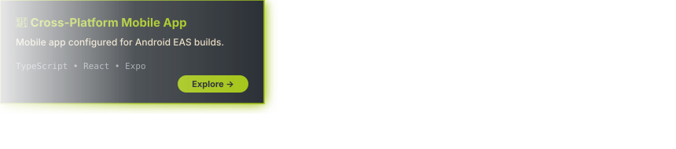

<!-- 

  

 -->

<!-- 

  

 -->

<!-- 

  

 -->
 

<table>
  <tr>
    <td width="35%" valign="middle" align="center">
      
    </td>
    <td width="65%" valign="middle">
      
     
    </td>
  </tr>
</table>
 

  

  

    
    
    
    
    
    
    
  

  

    
    
    
    
    
    
  

  

    
    
    
    
    
    
  

 

  

  
  

    
    
    
  

<picture>
  <source media="(prefers-color-scheme: dark)" srcset="https://raw.githubusercontent.com/gadniyibigira5/gadniyibigira5/output/github-snake-dark.svg" />
  <source media="(prefers-color-scheme: light)" srcset="https://raw.githubusercontent.com/gadniyibigira5/gadniyibigira5/output/github-snake.svg" />
  
</picture>

 

  
  

    
    
    
    
  

<!--
**gadniyibigira5/gadniyibigira5** is a ✨ _special_ ✨ repository because its `README.md` (this file) appears on your GitHub profile.

Here are some ideas to get you started:

- 🔭 I’m currently working on ...
- 🌱 I’m currently learning ...
- 👯 I’m looking to collaborate on ...
- 🤔 I’m looking for help with ...
- 💬 Ask me about ...
- 📫 How to reach me: ...
- 😄 Pronouns: ...
- ⚡ Fun fact: ...
-->
